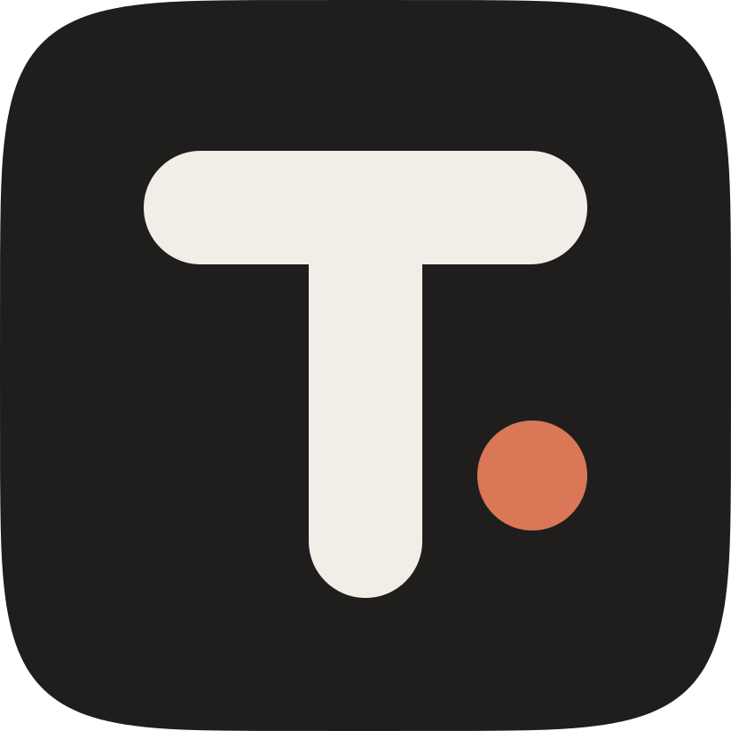
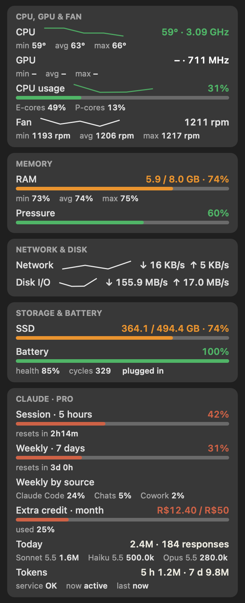
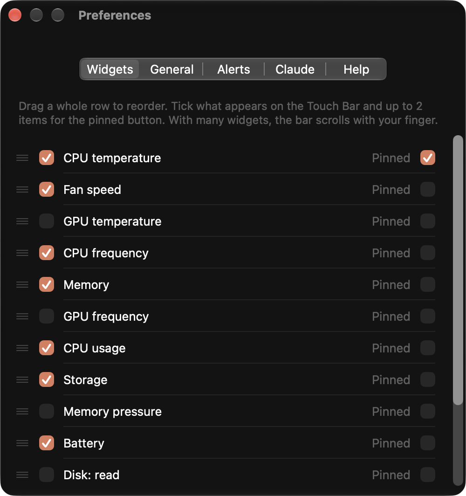
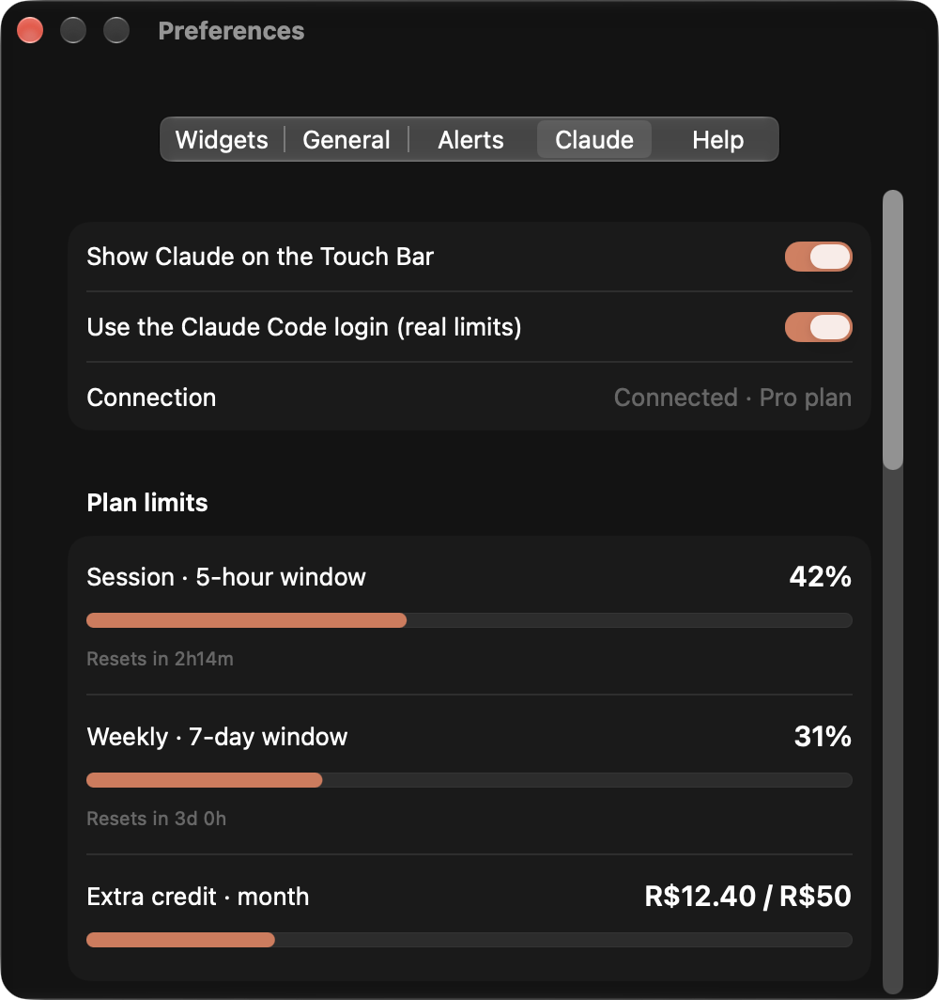

<p align="center">
  
</p>

<h1 align="center">Tato</h1>

<p align="center">
  <b>Mac and Claude metrics on the Touch Bar.</b><br>
  Temperature, fan, frequency, memory, network, battery and your Claude usage limits, always in sight.
</p>

<p align="center">
  <a href="https://github.com/waltinho17/tato/releases/latest"></a>
  
  
  
  
</p>

<p align="center">
  <a href="README.pt-BR.md">Português</a> · <b>English</b><br>
  <a href="https://waltinho17.github.io/tato/">Website</a> ·
  <a href="https://github.com/waltinho17/tato/releases/latest">Download</a> ·
  <a href="#getting-started">Getting started</a> ·
  <a href="#claude-mode">Claude mode</a> ·
  <a href="#privacy-and-security">Security</a>
</p>

<p align="center">
  <br>
  
</p>

> The Claude mode shots use sample data. The Mac mode shots are renders made by the app itself.

## What it is

Tato pins a button to the **Control Strip** of the Touch Bar (on the right, next to brightness and volume). Tapping it opens a bar with the widgets you choose. A panel in the menu bar shows the same and more, with min, average and max.

It is made for a MacBook Pro with a Touch Bar, it is light (about 0% CPU at rest), needs no `sudo` and has no Dock icon.

## Features

**Mac metrics**

| Metric | Source |
|---|---|
| CPU and GPU temperature | HID sensors (`pACC`, `eACC`, `GPU MTR`), SMC keys when present |
| Fan speed | SMC |
| CPU and GPU frequency | `libIOReport` with the `pmgr` frequency tables |
| CPU usage, E and P cores | `host_processor_info` |
| Memory and memory pressure | `host_statistics64`, `sysctl` |
| Network (down/up), disk (read/write) | `getifaddrs`, `IOBlockStorageDriver` |
| Storage, battery, health and cycles | public APIs and `AppleSmartBattery` |
| Top processes by CPU and RAM | `libproc`, grouped by app |

**Interface**

- A pinned Control Strip button with up to 2 values, and a full bar when tapped.
- A **scrollable** bar: as many widgets as you like, swipe to see them all.
- A menu bar panel with cards, coloured bars, sparklines and min/avg/max.
- Preferences with **draggable** widgets (the whole row), menu bar style (values, labelled or icon only) and a Liquid Glass look on macOS 26 and newer.
- **English and Portuguese**, following the system language (switchable in Preferences).
- Temperature alerts through notifications, with a 10-minute cool-down.
- Launch at login.
- Metrics your Mac cannot read **disappear by themselves**. If a sensor stops after a macOS update, the menu warns you.

<p align="center">
  
  
</p>

## Compatibility

You need a MacBook Pro **with a Touch Bar** and **macOS 13 Ventura or newer**.

| Mac | Chip | Status |
|---|---|---|
| MacBook Pro 13" (2020) | Apple M1 | **Tested** on macOS 27. All metrics and Claude mode. |
| MacBook Pro 13" (2022) | Apple M2 | Compatible, same sensors and APIs as the M1. **Not tested yet.** |
| MacBook Pro 13", 15" and 16" (2016 to 2020) | Intel | **Partial and untested.** Temperature and fan via SMC. No CPU/GPU frequency. Claude mode does not depend on hardware. |
| Macs without a Touch Bar | any | There is no Touch Bar. The menu bar panel may work, but it is not the focus. |

If you try it on another Mac, run `make probe` and open an issue with the result. It helps grow this table.

## Install

1. Download the `.zip` from the [releases page](https://github.com/waltinho17/tato/releases/latest), unzip it and drag **Tato** to Applications.
2. The app is not notarised by Apple. If macOS blocks it, run this once:
   ```bash
   xattr -cr /Applications/Tato.app
   ```
3. Open Tato. The icon appears in the menu bar.

To build from source (needs the Xcode Command Line Tools):

```bash
git clone https://github.com/waltinho17/tato.git
cd tato
make run      # builds, ad-hoc signs and opens
make probe    # prints every reading to the terminal and exits
make pkg      # builds the .pkg installer
```

## Getting started

1. **Open the app.** On the first run, Preferences opens on the Help tab with these steps.
2. **Keep the Control Strip visible.** In System Settings, Keyboard, Touch Bar Settings, choose "App Controls" and keep the Control Strip on. Avoid "Expanded Control Strip". Names vary a little between macOS versions.
3. **Look for the button** on the right of the Touch Bar, near brightness and volume.
4. **Tap it** to open the full bar. The ✕ closes it.
5. **Choose what to show** in Preferences, Widgets tab: tick, drag to reorder and use "Pinned" for up to 2 values on the button.

Nothing shows up? Check step 2 and reopen the app. A `–` value means your Mac cannot read that metric.

## Claude mode

A second Control Strip button, **independent** from the Mac mode. Minimised, it is just the little robot. Turn it on in Preferences, Claude tab.

<p align="center"></p>

- **Real plan limits:** the 5-hour session and the weekly limit, with a bar and the time until reset.
- **Monthly extra credit**, when the account has extra usage enabled, and **weekly usage by source** (Claude Code, chats, Cowork).
- **Today by model**, tokens for the last 5 hours and 7 days, live activity and service status.
- **Automatic:** it uses the login Claude Code already keeps in the Keychain, the same one used by the terminal, the VS Code extension and the app. macOS asks for permission the first time. Choose "Always Allow".
- **There when you start your Mac:** turning it on also enables "Launch at login", and the last known values show instantly.
- **What to show:** in General, "Touch Bar shows" accepts Mac and Claude, Mac metrics only or Claude only. Turning Claude mode off **removes the button completely**.

> **Heads up.** The limits come from an internal, **undocumented** Anthropic endpoint (`/api/oauth/usage`), queried with your own login every 5 minutes. It may change, be rate-limited or be restricted at any time, and the decision to use it is yours. You can turn it off with "Use the Claude Code login". Tokens and service status keep working without it.

## Privacy and security

The code is small, open and uses **no third-party libraries**. There is no analytics, no server of its own and no account.

**What the app sends over the network**, and nothing else:

| Destination | When | What goes |
|---|---|---|
| `status.claude.com` | Claude mode on, every 2 min | nothing beyond a public request |
| `api.anthropic.com/api/oauth/usage` | Claude mode and "use the login" on, every 5 min | your access token, in the `Authorization` header |

**About the Claude login**

- It is read from the Keychain **only with your permission** (macOS shows a prompt the first time).
- It lives **only in memory**. It is never written to a file, to `UserDefaults` or to a log.
- It goes only to the fixed Anthropic address over HTTPS (TLS 1.2 or newer), in an **ephemeral** session: no disk cache, no cookies and **no redirects followed**, so the token can never be forwarded elsewhere.
- The app **does not renew** the token. If it expires, it asks you to open Claude Code.

**About your conversations**

- Tokens are estimated from the local Claude Code logs (`~/.claude/projects`). The app reads only **date, model and token counts**. Conversation text is never stored or sent.

**What stays on your Mac:** your preferences and, so values show right after a restart, the last limits reading (percentages, reset times and credit amounts) in `UserDefaults`. No token.

**Known limits**

- It uses **private Apple APIs** (Control Strip, SMC, HID, IOReport). That is why it cannot be sandboxed or shipped on the App Store, and it can break on macOS updates.
- The app is ad-hoc signed and **not notarised**. Download only from the official repository and check the release's `SHA256SUMS`.
- The debug modes (`--probe`, `--snapshot`, `--demo`, `--prefs`, `--lang`) only work when the app is started from the command line and read nothing beyond what the app already reads.

Found a security problem? Open an issue without sensitive details, or reach the author through the GitHub profile.

## How it works

- **Control Strip:** `+[NSTouchBarItem addSystemTrayItem:]` and `DFRElementSetControlStripPresenceForIdentifier`, loaded at runtime with `dlopen`, the same technique as [MTMR](https://github.com/Toxblh/MTMR). The widget bar is an `NSScrubber`.
- **Sensors:** `IOHIDEventSystemClient` for temperature, `AppleSMC` for the fan, `libIOReport` and `pmgr` for frequency, as in [macmon](https://github.com/vladkens/macmon). SMC keys come from [Stats](https://github.com/exelban/stats).
- **Claude:** local logs read incrementally and de-duplicated, the public status page, and the usage endpoint with the Claude Code login.

```
Sources/touchbar-temp/
  Metrics/       data sources (SMC, HID, IOReport, network, disk, processes) and the engine
  TouchBar/      private Touch Bar APIs, controller, widgets and the panel
  Claude/        logs, limits, status, button and bar of the Claude mode
  Preferences/   SwiftUI Preferences window
  Palette.swift  one palette for the whole app
  Localization.swift  English and Portuguese
Tools/make-icon.swift   generates the app icon
Tools/site/             generates the bilingual website
docs/                   website (GitHub Pages) and images
```

## Troubleshooting

| Symptom | What to do |
|---|---|
| The button does not appear | Check the Control Strip in Touch Bar Settings and reopen the app. |
| A metric shows `–` | Your Mac cannot read it. Run `make probe` to see each sensor. |
| GPU shows `–` | The GPU is idle and its sensors return a fixed value. That is expected. |
| Orange warning in the menu | A sensor or API stopped responding, maybe after a macOS update. Open an issue with the `make probe` output. |
| Claude "not signed in" | Sign in to Claude Code once. If it says "expired", open Claude Code to renew it. |
| macOS blocks the app | `xattr -cr /Applications/Tato.app` |

## Credits and notices

Techniques inspired by MIT projects: [MTMR](https://github.com/Toxblh/MTMR), [Stats](https://github.com/exelban/stats) and [macmon](https://github.com/vladkens/macmon).

Tato is an independent project. **Mac, MacBook Pro and Touch Bar are trademarks of Apple Inc. Claude is a trademark of Anthropic.** This project is not affiliated with, sponsored by or endorsed by either. The pixel robot is a hand-drawn approximation made in code, not an official asset.

## License

[MIT](LICENSE)
