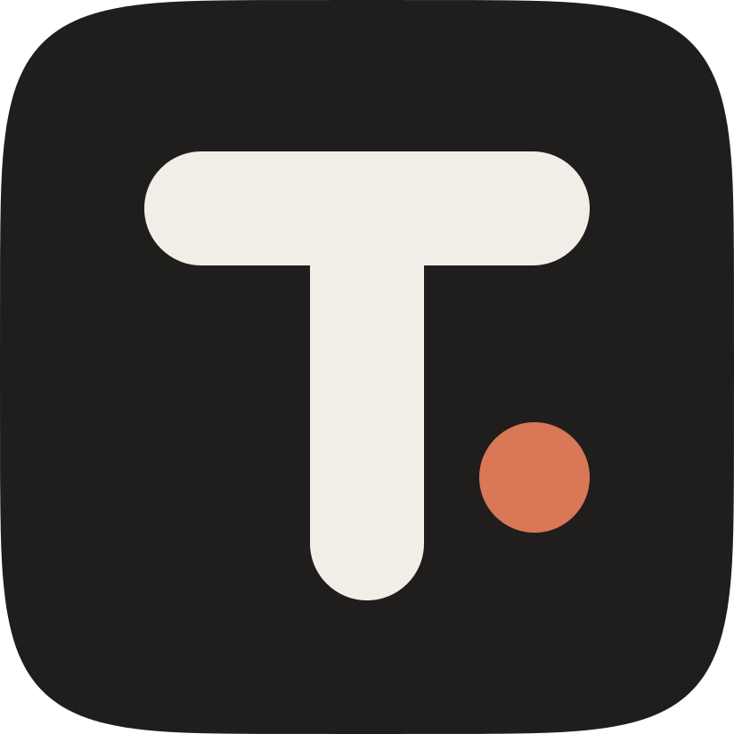
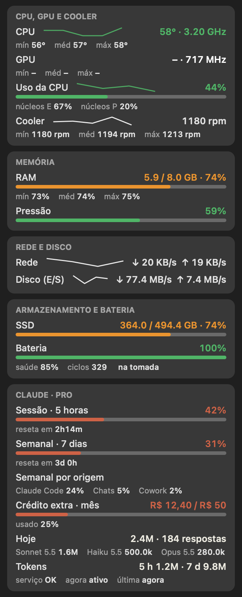
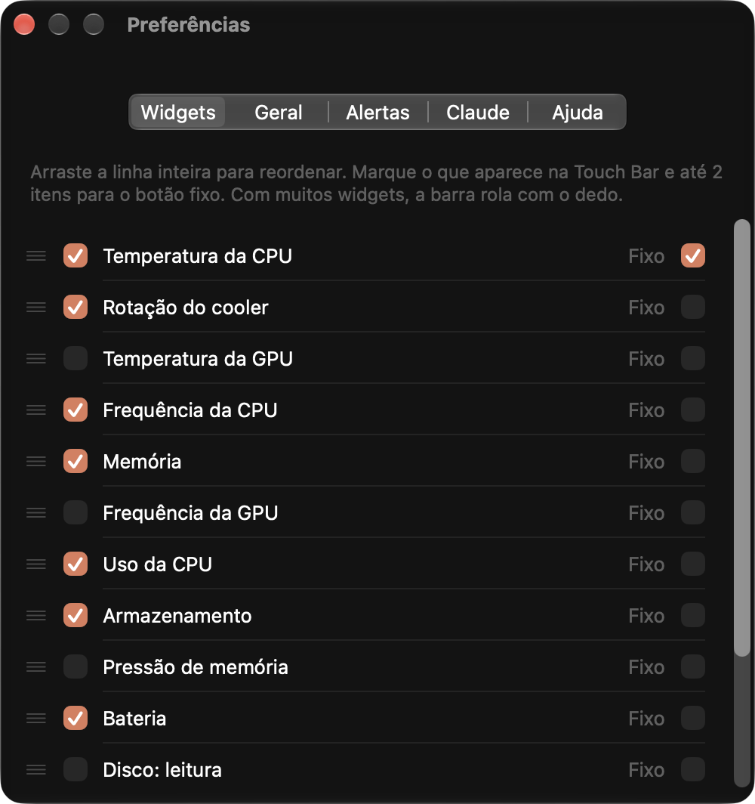
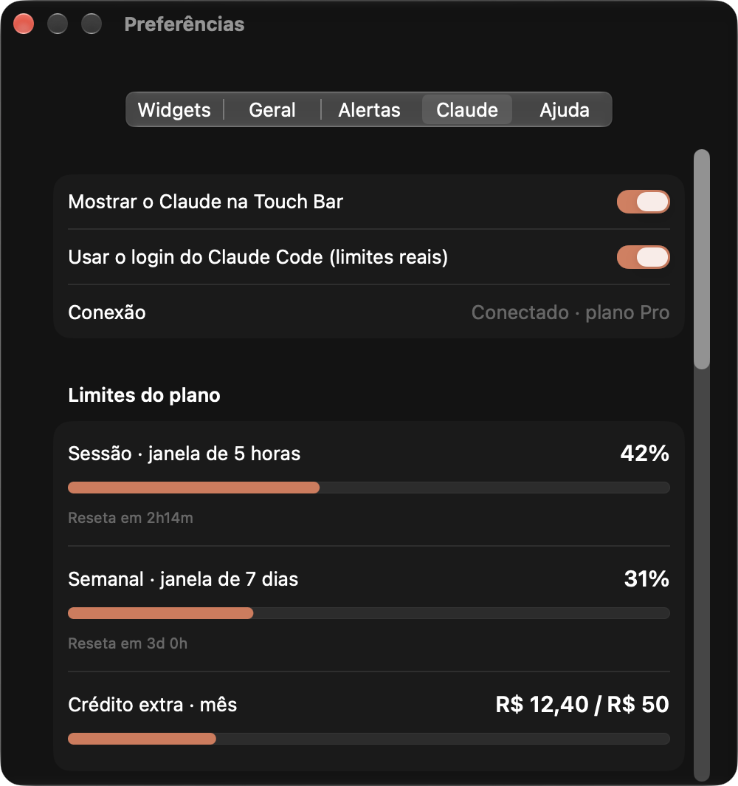

<p align="center">
  
</p>

<h1 align="center">Tato</h1>

<p align="center">
  <b>Métricas do Mac e do Claude na Touch Bar.</b><br>
  Temperatura, cooler, frequência, memória, rede, bateria e os limites do Claude, sempre à vista.
</p>

<p align="center">
  <a href="https://github.com/waltinho17/tato/releases/latest"></a>
  
  
  
  
</p>

<p align="center">
  <b>Português</b> · <a href="README.md">English</a><br>
  <a href="https://waltinho17.github.io/tato/pt/">Site</a> ·
  <a href="https://github.com/waltinho17/tato/releases/latest">Baixar</a> ·
  <a href="#primeiros-passos">Primeiros passos</a> ·
  <a href="#modo-claude">Modo Claude</a> ·
  <a href="#privacidade-e-seguran%C3%A7a">Segurança</a>
</p>

<p align="center">
  <br>
  
</p>

> Os prints do modo Claude usam dados de exemplo. Os do modo Mac são renderizações do app.

## O que é

O Tato fixa um botão na **Control Strip** da Touch Bar (à direita, junto de brilho e volume). Tocar nele abre uma barra com os widgets que você escolher. Um painel na barra de menus mostra o mesmo e mais, com mínimo, média e máximo.

Foi feito para um MacBook Pro com Touch Bar, é leve (cerca de 0% de CPU em repouso), não precisa de `sudo` e não tem ícone no Dock.

## Recursos

**Métricas do Mac**

| Métrica | De onde vem |
|---|---|
| Temperatura de CPU e GPU | sensores HID (`pACC`, `eACC`, `GPU MTR`), chaves SMC se existirem |
| Rotação do cooler | SMC |
| Frequência de CPU e GPU | `libIOReport` com as tabelas de frequência do `pmgr` |
| Uso da CPU, núcleos E e P | `host_processor_info` |
| Memória e pressão de memória | `host_statistics64`, `sysctl` |
| Rede (download e upload), disco (leitura e escrita) | `getifaddrs`, `IOBlockStorageDriver` |
| Armazenamento, bateria, saúde e ciclos | APIs públicas e `AppleSmartBattery` |
| Processos que mais usam CPU e RAM | `libproc`, agrupados por app |

**Interface**

- Botão fixo na Control Strip com até 2 valores, e barra completa ao tocar.
- Barra **rolável**: quantos widgets você quiser, deslize o dedo para ver todos.
- Painel na barra de menus com cartões, barras coloridas, mini-gráficos e mín/méd/máx.
- App em **português e inglês**, seguindo o idioma do sistema (dá para trocar nas Preferências).
- Preferências com widgets **arrastáveis** (a linha inteira), estilo da barra de menus (valores, com rótulo ou só ícone) e visual Liquid Glass no macOS 26 ou mais novo.
- Alertas de temperatura por notificação, com intervalo mínimo de 10 minutos.
- Abrir ao iniciar sessão.
- Métricas que o seu Mac não lê **somem sozinhas**. Se um sensor parar depois de uma atualização do macOS, o menu avisa.

<p align="center">
  
  
</p>

## Compatibilidade

Precisa de um MacBook Pro **com Touch Bar** e **macOS 13 Ventura ou mais novo**.

| Mac | Chip | Situação |
|---|---|---|
| MacBook Pro 13" (2020) | Apple M1 | **Testado** no macOS 27. Todas as métricas e o modo Claude. |
| MacBook Pro 13" (2022) | Apple M2 | Compatível, mesmos sensores e APIs do M1. **Ainda não testado.** |
| MacBook Pro 13", 15" e 16" (2016 a 2020) | Intel | **Parcial e não testado.** Temperatura e cooler pelo SMC. Sem frequência de CPU e GPU. O modo Claude não depende do hardware. |
| Macs sem Touch Bar | qualquer | Não há Touch Bar. O painel da barra de menus pode funcionar, mas não é o foco. |

Se você testar em outro Mac, rode `make probe` e abra uma issue com o resultado. Isso ajuda a ampliar a tabela.

## Instalação

1. Baixe o `.zip` na [página de versões](https://github.com/waltinho17/tato/releases/latest), descompacte e arraste o **Tato** para Aplicativos.
2. O app não é notarizado pela Apple. Se o macOS bloquear, rode uma vez:
   ```bash
   xattr -cr /Applications/Tato.app
   ```
3. Abra o Tato. O ícone aparece na barra de menus.

Para compilar do código-fonte (precisa do Xcode Command Line Tools):

```bash
git clone https://github.com/waltinho17/tato.git
cd tato
make run      # compila, assina ad-hoc e abre
make probe    # imprime todas as leituras no terminal e sai
make pkg      # gera o instalador .pkg
```

## Primeiros passos

1. **Abra o app.** Na primeira execução, as Preferências abrem na aba Ajuda com este passo a passo.
2. **Deixe a Control Strip visível.** Em Ajustes do Sistema, Teclado, Configurações da Touch Bar, escolha "Controles do app" e mantenha a Control Strip ativada. Evite "Control Strip expandida". Os nomes variam um pouco conforme a versão do macOS.
3. **Procure o botão** à direita da Touch Bar, perto de brilho e volume.
4. **Toque nele** para abrir a barra completa. O ✕ fecha.
5. **Escolha o que mostrar** em Preferências, aba Widgets: marque, arraste para reordenar e use "Fixo" para até 2 valores no botão.

Nada aparece? Confira o passo 2 e reabra o app. Um valor `–` significa que o Mac não lê aquela métrica.

## Modo Claude

Um segundo botão na Control Strip, **independente** do modo Mac. Minimizado, é só o robozinho. Ative em Preferências, aba Claude.

<p align="center"></p>

- **Limites reais do plano:** sessão de 5 horas e semanal, com barra e tempo para resetar.
- **Crédito extra do mês**, quando a conta tem uso extra ativado, e o **uso semanal por origem** (Claude Code, chats, Cowork).
- **Hoje por modelo**, tokens das últimas 5 horas e de 7 dias, atividade em tempo real e status do serviço.
- **Automático:** usa o login que o Claude Code já guarda no Chaveiro, o mesmo do terminal, da extensão do VS Code e do app. O macOS pede permissão na primeira vez. Escolha "Permitir sempre".
- **Já aparece ao ligar o Mac:** ao ativar, o Tato liga "Abrir ao iniciar sessão" e mostra os últimos valores conhecidos na hora.
- **O que mostrar:** em Geral, "Touch Bar mostra" aceita Mac e Claude, só métricas do Mac ou só Claude. Desligar o modo Claude **remove o botão por completo**.

> **Aviso.** Os limites vêm de um endereço interno e **não documentado** da Anthropic (`/api/oauth/usage`), consultado com o seu próprio login, a cada 5 minutos. Ele pode mudar, ser limitado ou ser restringido a qualquer momento, e a decisão de usá-lo é sua. Dá para desligar em "Usar o login do Claude Code". Os tokens e o status do serviço funcionam mesmo sem ele.

## Privacidade e segurança

O código é pequeno, aberto e **não usa nenhuma biblioteca de terceiros**. Não há análise de uso, servidor próprio nem conta.

**O que o app envia pela rede**, e só isso:

| Destino | Quando | O que vai |
|---|---|---|
| `status.claude.com` | modo Claude ligado, a cada 2 min | nada além de uma requisição pública |
| `api.anthropic.com/api/oauth/usage` | modo Claude ligado e "usar o login" ligado, a cada 5 min | o token de acesso do seu login, no cabeçalho `Authorization` |

**Sobre o login do Claude**

- É lido do Chaveiro **somente com a sua permissão** (o macOS mostra um aviso na primeira vez).
- Fica **só na memória**. Nunca é gravado em arquivo, em `UserDefaults` nem em log.
- Vai apenas para o endereço fixo da Anthropic, por HTTPS (TLS 1.2 ou mais novo), numa sessão **efêmera**: sem cache em disco, sem cookies e **sem seguir redirecionamentos**, para que o token nunca seja encaminhado a outro destino.
- O app **não renova** o token. Se expirar, ele pede para você abrir o Claude Code.

**Sobre as suas conversas**

- Os tokens são estimados a partir dos logs locais do Claude Code (`~/.claude/projects`). O app lê apenas **data, modelo e contagem de tokens**. O texto das conversas nunca é guardado nem enviado.

**O que fica no seu Mac:** as preferências e, para mostrar valores logo após reiniciar, a última leitura dos limites (percentuais, horários de reset e valores de crédito) em `UserDefaults`. Nenhum token.

**Limites conhecidos**

- Usa **APIs privadas** da Apple (Control Strip, SMC, HID, IOReport). Por isso não pode ser sandboxed nem publicado na App Store, e pode quebrar em atualizações do macOS.
- O app é assinado com assinatura ad-hoc e **não é notarizado**. Baixe apenas do repositório oficial e confira o `SHA256SUMS` do release.
- Os modos de depuração (`--probe`, `--snapshot`, `--demo`, `--prefs`, `--lang`) só funcionam quando o app é iniciado por linha de comando e não leem nada além do que o app já lê.

Encontrou um problema de segurança? Abra uma issue sem detalhes sensíveis ou fale com o autor pelo perfil do GitHub.

## Como funciona

- **Control Strip:** `+[NSTouchBarItem addSystemTrayItem:]` e `DFRElementSetControlStripPresenceForIdentifier`, carregados em tempo de execução com `dlopen`, a mesma técnica do [MTMR](https://github.com/Toxblh/MTMR). A barra de widgets é um `NSScrubber`.
- **Sensores:** `IOHIDEventSystemClient` para temperatura, `AppleSMC` para cooler, `libIOReport` e o `pmgr` para frequência, como no [macmon](https://github.com/vladkens/macmon). As chaves SMC vêm do [Stats](https://github.com/exelban/stats).
- **Claude:** logs locais em leitura incremental e deduplicada, a página de status pública e o endpoint de uso com o login do Claude Code.

```
Sources/touchbar-temp/
  Metrics/       fontes de dados (SMC, HID, IOReport, rede, disco, processos) e o motor
  TouchBar/      APIs privadas da Touch Bar, controlador, widgets e painel
  Claude/        logs, limites, status, botão e barra do modo Claude
  Preferences/   janela de Preferências em SwiftUI
  Palette.swift  paleta única do app
Tools/make-icon.swift   gera o ícone do app
docs/                   site (GitHub Pages) e imagens
```

## Solução de problemas

| Sintoma | O que fazer |
|---|---|
| O botão não aparece | Confira a Control Strip em Configurações da Touch Bar e reabra o app. |
| Métrica com `–` | O Mac não lê essa métrica. Rode `make probe` para ver cada sensor. |
| GPU mostra `–` | A GPU está parada e os sensores devolvem um valor fixo. É esperado. |
| Aviso laranja no menu | Um sensor ou API parou de responder, talvez após atualizar o macOS. Abra uma issue com o `make probe`. |
| Claude "sem login" | Entre no Claude Code uma vez. Se estiver "expirado", abra o Claude Code para renovar. |
| macOS bloqueia o app | `xattr -cr /Applications/Tato.app` |

## Créditos e avisos

Técnicas inspiradas em projetos MIT: [MTMR](https://github.com/Toxblh/MTMR), [Stats](https://github.com/exelban/stats) e [macmon](https://github.com/vladkens/macmon).

O Tato é um projeto independente. **Mac, MacBook Pro e Touch Bar são marcas da Apple Inc. Claude é marca da Anthropic.** Este projeto não é afiliado, patrocinado nem endossado por nenhuma das duas. O robozinho pixelado é uma aproximação desenhada em código, não um arquivo oficial.

## Licença

[MIT](LICENSE)
